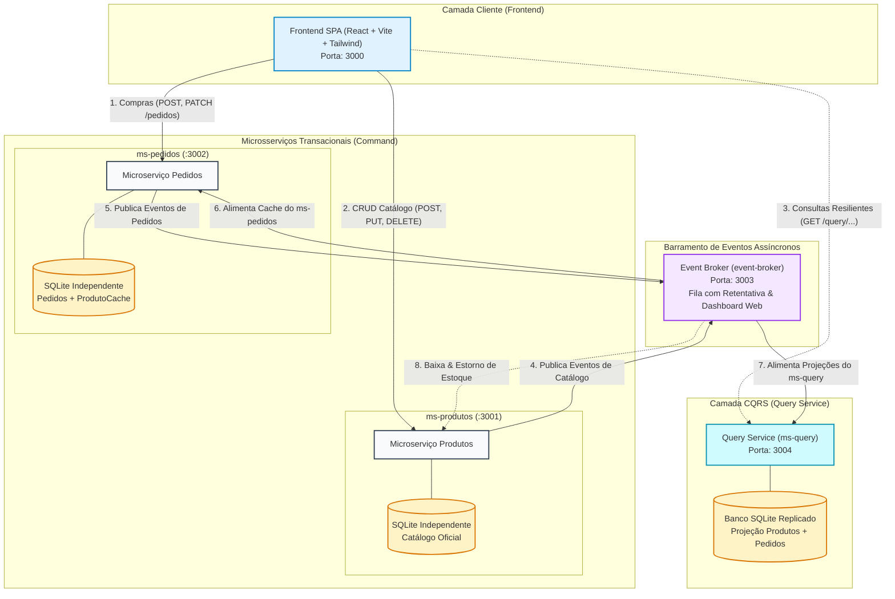

# Sistema Distribuído de Catálogo e Pedidos — Arquitetura de Microserviços

**Instituição:** Instituto Federal de Educação, Ciência e Tecnologia de São Paulo (IFSP)  
**Curso / Disciplina:** Tecnologia em Análise e Desenvolvimento de Sistemas | DSW 3 (Desenvolvimento Web 3)  
**Docente Responsável:** Prof. Me. André Luís Bordignon  
**Aluno:** Enzo Alves dos Santos Souza  
**Matrícula:** CP3025802  
**Status do Projeto:** 100% Implementado (Momentos 1, 2, 3 e 4)

---

## 1. Visão Geral do Sistema

Aplicação web distribuída de ponta a ponta desenvolvida sob o padrão arquitetural de **Microserviços**, composta por dois serviços de backend independentes (`ms-produtos` e `ms-pedidos`) e uma aplicação cliente única desenvolvida em **React (Vite)** com foco em alta resiliência, degradação graciosa e tolerância a falhas.

### Padrões Arquiteturais Implementados
- **Database-per-Service:** Cada microsserviço gerencia exclusivamente sua própria base de dados relacional (SQLite via Prisma ORM). O isolamento é total: nenhum microsserviço realiza consultas diretas ao banco do outro.
- **Snapshot Pattern:** No momento da realização de um pedido (`POST /pedidos`), o `ms-pedidos` grava uma **cópia imutável** do `nomeProduto` e do `precoUnitario` no banco de pedidos. Isso impede que atualizações cadastrais ou alterações de preços futuras distorçam o histórico contábil/financeiro das compras já efetuadas.
- **Event-Driven Architecture & Cache Local Replicado (Materialized View):** O sistema conta com um **Event Broker** dedicado (`event-broker`, porta 3003) com garantia de entrega (*at-least-once*) e retentativas automáticas. O `ms-produtos` publica eventos de ciclo de vida (`PRODUTO_CRIADO`, `PRODUTO_ATUALIZADO`, `ESTOQUE_ATUALIZADO`, `PRODUTO_EXCLUIDO`), enquanto o `ms-pedidos` os consome e mantém sua própria tabela `ProdutoCache`.
- **CQRS & Query Service Dedicado (ms-query, porta 3004):** O sistema agora conta com um microsserviço de consulta dedicado que implementa o padrão **CQRS (Command Query Responsibility Segregation)**. O `ms-query` mantém uma réplica consolidada dos bancos de dados (projeções de leitura de Produtos e Pedidos) alimentada via `event-broker`. As leituras no frontend e análises agregadas ocorrem com latência ultra-baixa sem competir por recursos de I/O com os serviços transacionais de escrita.
- **Desacoplamento Temporal e Alta Resiliência (Zero Single Point of Failure):** Se o `ms-produtos` cair, o `ms-pedidos` continua realizando pedidos via Cache Replicado (com modo síncrono estrito opcional via header `X-Sync-Strict: true`) e o Frontend continua visualizando produtos e pedidos através do `ms-query` (ou cache local). Se o `ms-pedidos` cair, o Frontend enfileira novos pedidos (`PEDIDO_CRIAR_COMANDO`) e cancelamentos (`PEDIDO_CANCELAR_COMANDO`) no `event-broker` via padrão **Store-and-Forward**, com consumo idempotente (**Inbox Pattern / `EventoProcessado`**) evitando baixas ou estornos duplicados.
- **Compensação e Ciclo de Vida (Saga & Estorno de Estoque):** Na criação do pedido, o `ms-pedidos` realiza validação e reserva síncrona de estoque no `ms-produtos` com `idempotencyKey` e compensação automática (Saga) caso a gravação local falhe. No cancelamento (`PATCH /pedidos/:id/cancelar`), estorna o estoque de forma idempotente e publica `PEDIDO_CANCELADO` no broker para manter o `ms-query` e os caches sincronizados.

---

## 2. Diagrama Arquitetural e Topologia de Serviços



---

## 3. Matriz de Componentes e Tecnologias

| Componente | Diretório | Tecnologias Principais | Porta | Persistência / Volume |
| :--- | :--- | :--- | :---: | :--- |
| **event-broker** | `/event-broker` | Node.js 20, Express, Pub/Sub, Queue Retry | `3003` | Volume Docker `broker-data` (`/app/data`) |
| **ms-query** | `/ms-query` | Node.js 20, Express, Prisma ORM, CQRS Read Model | `3004` | Volume Docker `query-data` (`/app/prisma/data`) |
| **ms-produtos** | `/ms-produtos` | Node.js 20, Express, Prisma ORM, SQLite | `3001` | Volume Docker `produtos-data` (`/app/prisma/data`) |
| **ms-pedidos** | `/ms-pedidos` | Node.js 20, Express, Prisma ORM, SQLite, Cache | `3002` | Volume Docker `pedidos-data` (`/app/prisma/data`) |
| **Frontend** | `/frontend` | React 18, Vite, Axios, Tailwind CSS, Lucide | `3000` | N/A (Build SPA estático multi-stage Nginx) |
| **Orquestrador** | `/` | Docker Compose (v3.8) | — | Rede interna `dsw3-network` (bridge) |

---

## 4. Especificação dos Contratos de API (Endpoints)

### 4.1. Microserviço de Produtos (`http://localhost:3001`)

| Método | Endpoint | Descrição / Regra | Códigos HTTP |
| :--- | :--- | :--- | :--- |
| `GET` | `/health` | Health check da saúde do serviço | `200 OK` |
| `GET` | `/produtos` | Listar todos os produtos do catálogo (ordenados por nome) | `200 OK` |
| `GET` | `/produtos/:id` | Buscar detalhes de um produto por UUID | `200 OK`, `404 Not Found` |
| `POST` | `/produtos` | Cadastrar novo produto no catálogo (CRUD) | `201 Created`, `400 Bad Request` |
| `PUT` | `/produtos/:id` | Atualizar dados completos do produto (CRUD) | `200 OK`, `400`, `404` |
| `DELETE`| `/produtos/:id` | Excluir produto do catálogo (CRUD) | `200 OK`, `404 Not Found` |
| `PATCH`| `/produtos/:id/estoque` | Atualizar saldo de estoque (`subtrair` ou `adicionar`) | `200 OK`, `400`, `404` |

#### Payload de Exemplo (Cadastro / Edição de Produto):
```json
{
  "nome": "Monitor Gamer 27 165Hz",
  "preco": 1250.00,
  "descricao": "Monitor IPS 1ms FreeSync HDR",
  "estoque": 15
}
```

---

### 4.2. Microserviço de Pedidos (`http://localhost:3002`)

| Método | Endpoint | Descrição / Regra | Códigos HTTP |
| :--- | :--- | :--- | :--- |
| `GET` | `/health` | Health check da saúde do serviço | `200 OK` |
| `GET` | `/pedidos` | Listar histórico de pedidos (mais recentes primeiro) | `200 OK` |
| `GET` | `/pedidos/:id` | Obter detalhes e snapshot de um pedido por UUID | `200 OK`, `404 Not Found` |
| `POST` | `/pedidos` | Criar pedido com validação/reserva síncrona HTTP + Snapshot Pattern (status `REALIZADO`) | `201 Created`, `400`, `404`, `503` |
| `PATCH`| `/pedidos/:id/cancelar` | Cancelar pedido (status `CANCELADO`) e estornar estoque de forma idempotente | `200 OK`, `400`, `404` |

#### Payload de Exemplo (Criação de Pedido):
```json
{
  "produtoId": "4905338d-8204-45c1-b908-90c7fd305d55",
  "quantidade": 2
}
```

#### Comunicação Síncrona, Resiliência e Códigos HTTP:
- **`201 Created`**: Pedido aprovado com sucesso, contendo o snapshot imutável do nome e preço unitário. O header de resposta `X-Validation-Mode` indica `sync-http` (validação e baixa síncrona no `ms-produtos`) ou `cache-fallback` (fallback resiliente via `ProdutoCache` quando `ms-produtos` está offline e `USE_CACHE_FALLBACK=true`).
- **`400 Bad Request`**: Quantidade inválida ou superior ao estoque disponível no catálogo.
- **`404 Not Found`**: Produto informado não existe no catálogo (remove também eventual resíduo do cache local).
- **`503 Service Unavailable`**: Retornado quando o `ms-produtos` está offline e o item não existe no `ProdutoCache`, ou quando o cliente exige modo síncrono estrito via header `X-Sync-Strict: true` (ou `?strict=true` / `USE_CACHE_FALLBACK=false`).

---

### 4.3. Event Broker (`http://localhost:3003`)

| Método | Endpoint | Descrição / Regra | Códigos HTTP |
| :--- | :--- | :--- | :--- |
| `GET` | `/` | Dashboard web em tempo real de tópicos, subscribers e fila de eventos | `200 OK` |
| `GET` | `/health` | Status do broker, quantidade de assinantes e entregas pendentes | `200 OK` |
| `GET` | `/events` | Histórico de eventos trafegados e status de entrega (`QUEUED`, `RETRYING`, `DELIVERED`) | `200 OK` |
| `POST` | `/subscribe` | Registrar webhook de um microsserviço em um tópico (`produtos` ou `pedidos`) | `200 OK`, `400` |
| `POST` | `/publish` | Publicar evento ou comando Store-and-Forward para entrega FIFO garantida | `202 Accepted`, `400` |

---

### 4.4. Query Service — CQRS (`http://localhost:3004`)

| Método | Endpoint | Descrição / Regra | Códigos HTTP |
| :--- | :--- | :--- | :--- |
| `GET` | `/` | Dashboard visual da projeção consolidada CQRS | `200 OK` |
| `GET` | `/health` | Health check com contagem de produtos e pedidos indexados | `200 OK` |
| `GET` | `/query/produtos` | Listar catálogo a partir do Read Model replicado | `200 OK` |
| `GET` | `/query/produtos/:id` | Consultar produto na projeção CQRS | `200 OK`, `404` |
| `GET` | `/query/pedidos` | Listar histórico de pedidos com snapshots preservados | `200 OK` |
| `GET` | `/query/pedidos/:id` | Consultar detalhes de um pedido na projeção CQRS | `200 OK`, `404` |
| `GET` | `/query/resumo` | Resumo analítico consolidado (estoque global, pedidos `REALIZADO`/`CANCELADO` e faturamento) | `200 OK` |

---

## 5. Como Executar o Projeto

### Opção 1: Via Docker Compose (Recomendado — Um Único Comando)

Com o Docker e Docker Compose instalados na máquina:

```bash
# Na raiz do projeto, construa as imagens e inicialize todos os 5 contêineres:
docker compose up --build
```

Todos os serviços estarão imediatamente acessíveis:
- **Frontend SPA:** [http://localhost:3000](http://localhost:3000)
- **API de Produtos (`ms-produtos`):** [http://localhost:3001](http://localhost:3001) (Health: `/health`)
- **API de Pedidos (`ms-pedidos`):** [http://localhost:3002](http://localhost:3002) (Health: `/health`)
- **Event Broker (`event-broker`):** [http://localhost:3003](http://localhost:3003) (Painel web + Health: `/health`)
- **Query Service CQRS (`ms-query`):** [http://localhost:3004](http://localhost:3004) (Dashboard CQRS + Health: `/health`)

Para parar os serviços mantendo a persistência dos dados:
```bash
docker compose down
```

---

### Opção 2: Execução Local Tradicional (Node.js)

#### 1. Instalar Dependências
```bash
cd event-broker && npm install
cd ../ms-produtos && npm install && cp .env.example .env
cd ../ms-pedidos && npm install && cp .env.example .env
cd ../ms-query && npm install && cp .env.example .env
cd ../frontend && npm install
```

#### 2. Sincronizar Bancos de Dados SQLite (Prisma)
```bash
# Em ms-produtos:
cd ms-produtos
npx prisma generate
npx prisma db push

# Em ms-pedidos:
cd ../ms-pedidos
npx prisma generate
npx prisma db push

# Em ms-query:
cd ../ms-query
npx prisma generate
npx prisma db push
```

#### 3. Iniciar os Serviços (5 Terminais)
```bash
# Terminal 1 — event-broker
cd event-broker && npm run dev   # Roda em http://localhost:3003

# Terminal 2 — ms-produtos
cd ms-produtos && npm run dev    # Roda em http://localhost:3001

# Terminal 3 — ms-pedidos
cd ms-pedidos && npm run dev     # Roda em http://localhost:3002

# Terminal 4 — ms-query
cd ms-query && npm run dev       # Roda em http://localhost:3004

# Terminal 5 — Frontend
cd frontend && npm run dev       # Roda em http://localhost:3000
```

---

## 6. Roteiro para Apresentação Prática e Arguição Técnica

Para as bancas avaliativas dos **Momentos 2 e 4**, utilize o roteiro prático abaixo:

### Teste 1: Demonstração do Snapshot Pattern
1. Acesse o Frontend em `http://localhost:3000` (Aba **Vitrine de Produtos**).
2. Cadastre um novo produto com preço **R$ 100,00** e estoque **10**.
3. Vá para a aba **Fazer Compra**, selecione o produto criado e compre **2 unidades**.
4. Acesse a aba **Meus Pedidos** e comprove que o pedido está gravado com status `REALIZADO` a **R$ 100,00 cada** (Total: R$ 200,00) e que o estoque caiu exatamente para **8 unidades** (sem baixa duplicada).
5. Retorne à vitrine, clique no botão de **Editar** do produto e mude o preço dele para **R$ 250,00**.
6. Volte à aba **Meus Pedidos**: o pedido anterior continuará exatamente com o preço unitário congelado em **R$ 100,00**!

### Teste 2: Cancelamento de Pedido e Recomposição de Estoque
1. Em **Meus Pedidos**, localize o pedido ativo (`REALIZADO`) e clique no botão **Cancelar**.
2. O pedido mudará o status para `CANCELADO`.
3. Verifique a **Vitrine de Produtos**: as 2 unidades compradas retornaram exatamente uma vez ao estoque disponível (**10 unidades**).

### Teste 3: Cenários de Erro (400, 404 e 503 Síncrono Estrito)
1. Tente realizar um pedido com quantidade superior ao estoque atual. A interface exibirá validação local e, se forçado via API, responderá `HTTP 400` com a mensagem orientativa de quantidade disponível.
2. Tente consultar ou pedir um UUID inexistente via Postman: retorno `HTTP 404`.
3. Com o `ms-produtos` desligado, envie `POST /pedidos` com o header `X-Sync-Strict: true` via Postman: retorno `HTTP 503 Service Unavailable`.

### Teste 4: Tolerância a Falhas com `ms-produtos` Offline (Cache Replicado + Broker)
1. Com todos os serviços rodando, abra o **Monitor do Event Broker** em `http://localhost:3003` para acompanhar mensagens trafegadas e retentativas em tempo real.
2. No terminal do Docker, derrube o `ms-produtos`:
   ```bash
   docker stop ms-produtos
   ```
3. Observe o **Monitor de Serviços** no topo do frontend: a badge do `produtos :3001` ficará vermelha, o catálogo continuará sendo servido via `ms-query` / cache local, e novos cadastros/edições de produtos serão enfileirados via Store-and-Forward.
4. Vá para a aba **Fazer Compra** e **realize um pedido normalmente:** o `ms-pedidos` consulta seu `ProdutoCache` independente, aprova o pedido (`HTTP 201 Created`, header `X-Validation-Mode: cache-fallback`) e congela o snapshot.
5. Olhe no painel do **Event Broker** (`http://localhost:3003`): o evento `PEDIDO_CRIADO` estará retido em fila (`RETRYING`) para `ms-produtos`.
6. Religue o serviço de produtos:
   ```bash
   docker start ms-produtos
   ```
7. Em segundos, o Broker entrega a mensagem pendente (`DELIVERED`) e o estoque oficial no SQLite do `ms-produtos` é atualizado retroativamente uma única vez (garantido por idempotência).

### Teste 5: Tolerância a Falhas com `ms-pedidos` Offline (Store-and-Forward + CQRS)
1. Derrube o `ms-pedidos`:
   ```bash
   docker stop ms-pedidos
   ```
2. No frontend, observe o banner informando que o histórico segue disponível via `ms-query` (`:3004`) e novos pedidos/cancelamentos serão enfileirados no Broker (`:3003`).
3. Realize uma compra na aba **Fazer Compra**: o frontend publica `PEDIDO_CRIAR_COMANDO` no Event Broker (`202 Accepted`), exibe Toast de aviso e o `ms-query` já projeta o novo pedido com o nome e snapshot corretos enquanto o `ms-produtos` dá baixa no estoque.
4. Religue o `ms-pedidos`:
   ```bash
   docker start ms-pedidos
   ```
5. O Broker entrega o comando pendente (`PEDIDO_CRIAR_COMANDO`), o `ms-pedidos` grava o pedido em seu próprio SQLite com idempotência e o estoque oficial permanece consistente sem duplicidade.

---

## 7. Coleção de Testes do Postman / Insomnia

O repositório disponibiliza na raiz o arquivo **[`dsw3-postman-collection.json`](./dsw3-postman-collection.json)**.
Ele inclui requisições pré-configuradas com variáveis de ambiente para:
- `POST /produtos` (Cadastro)
- `GET /produtos` (Listagem)
- `GET /produtos/:id` (Busca por ID)
- `PUT /produtos/:id` (Edição completa)
- `DELETE /produtos/:id` (Exclusão)
- `POST /pedidos` (Sucesso 201 com Snapshot)
- `POST /pedidos` (Erro 400 — Estoque insuficiente)
- `POST /pedidos` (Erro 404 — Produto inexistente)
- `POST /pedidos` (Erro 503 — Modo síncrono estrito `X-Sync-Strict: true` com `ms-produtos` offline)
- `GET /pedidos` (Listagem com snapshots)
- `GET /pedidos/:id` (Detalhes)
- `PATCH /pedidos/:id/cancelar` (Cancelamento e estorno)
- `GET /health` (Health check em ambos os serviços)

---

## 8. Testes Automatizados (Jest + Playwright)

O repositório conta com suítes automatizadas na raiz usando **Jest** (testes de API, integração, Snapshot Pattern e resiliência) e **Playwright** (testes E2E no navegador real):

### Instalar dependências de teste (na raiz)
```bash
npm install
```

### Rodar os testes de API e Resiliência (Jest)
Os testes sobem um cluster isolado temporário (portas `4301`–`4304` e SQLites temporários), sem interferir nos containers do Docker Compose:
```bash
npm run test:api
```

### Rodar os testes E2E no navegador (Playwright)
Com a aplicação rodando (ex.: `docker compose up -d` em `http://localhost:3000`):
```bash
npm run test:e2e
```
Para acompanhar visualmente no navegador:
```bash
npm run test:e2e:headed
```

### Rodar toda a suíte
```bash
npm test
```
